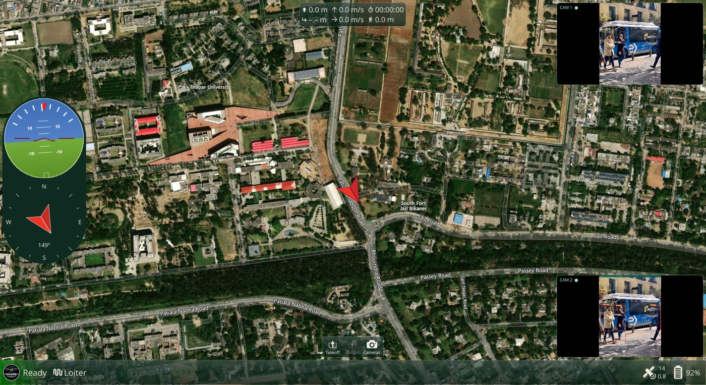
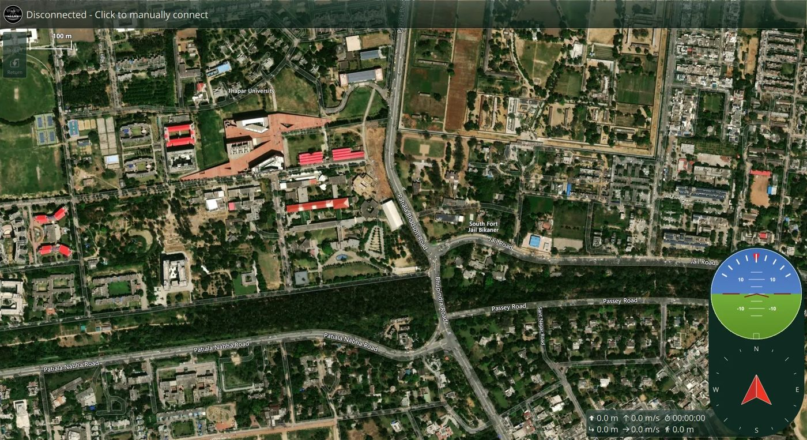
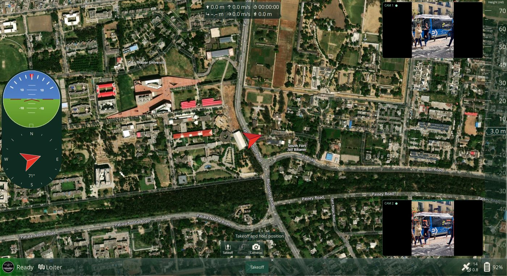
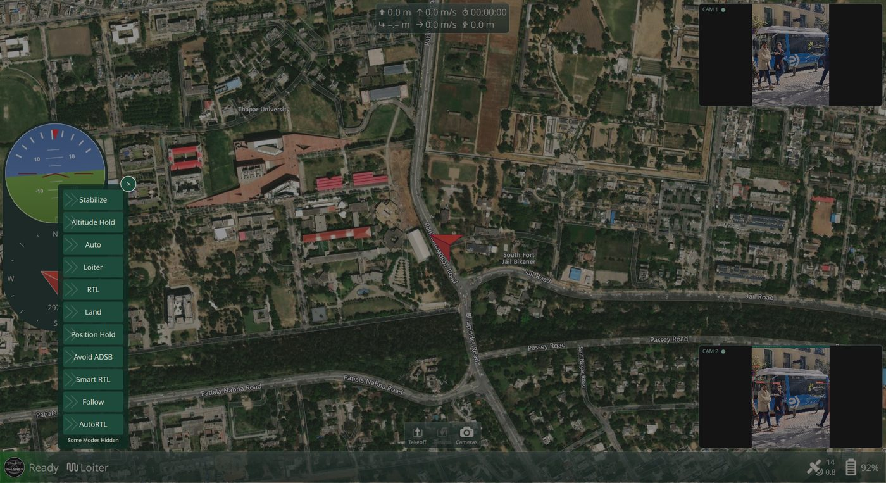
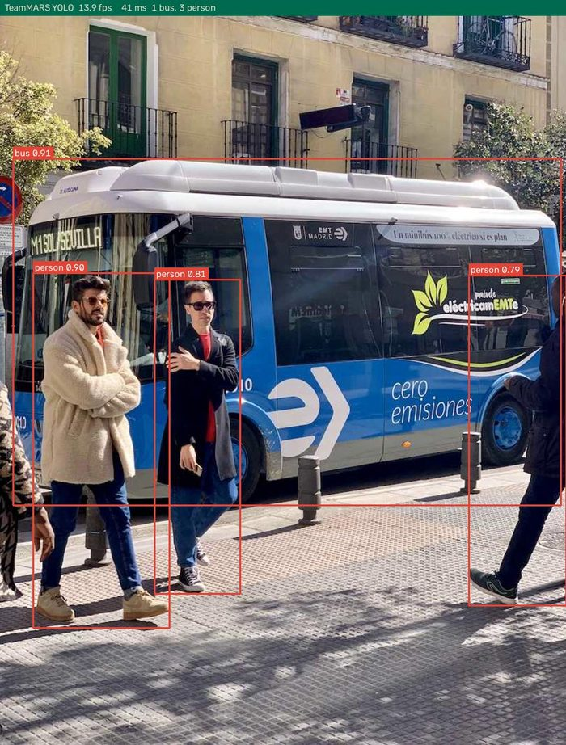

<p align="center"></p>

<h1 align="center">TeamMARS-Telemetry</h1>
<p align="center"><b>A pilot-first ground station for ArduPilot drones — with dual live cameras and on-board AI vision.</b><br>
Built on QGroundControl 5.1.5. Every flight feature of the original, rearranged around the pilot.</p>

<p align="center">
<a href="https://github.com/prashaantsharma07/ISDC-27/releases/latest"><b>⬇ Download v2.2 (Linux AppImage)</b></a>
</p>



## Why ours beats the stock layout

| | Stock QGroundControl | **TeamMARS-Telemetry v2.0** |
|---|---|---|
| **Where your eyes go** | Instruments bottom-right, actions top-left, status top — gaze zig-zags across the screen | **Symmetric cockpit**: attitude + compass on the left edge at eye level, numbers centred on top, controls centred at the bottom |
| **Takeoff / Land / RTL / Pause** | Vertical strip in the top-left corner | **Centred row right above the status bar** — one short reach, the same spot every flight |
| **Status bar** | Top | **Bottom**, like a car dashboard; every pop-up (battery, GPS, flight modes, menu) opens **upward** from where you clicked |
| **Live video** | One video picture-in-picture | **Two camera panels, each half the screen height** (top-right + bottom-right) with **network streams or USB capture (FPV receivers / HDMI grabbers), fill/fit, flip, mirror, swap, 3 widths** — all remembered; the map, numbers and controls re-centre beside them |
| **AI on the camera** | None | **TeamMARS Vision**: YOLO object detection or OpenCV motion/edges, shown live in panel 2 |
| **Map space** | Panels can cover the vehicle | Every panel reports its size; the map keeps the vehicle in the clear space between them |
| **Look** | Flat grey | **Liquid-glass** UI in bottle green, bone and vermilion — drawn with gradients, no blur, so no FPS cost |
| **Safety colours** | Green / yellow / red | **Untouched** — and "Disconnected" is neutral charcoal so it can never be mistaken for green "Ready to fly" |
| **Flight logic, MAVLink, parameters** | — | **Identical** — we only changed the interface |

### Measured, not guessed (laptop: Intel i7-10750H, CPU only)
- **YOLO11n object detection: 27 ms per frame, ~18.6 fps** — test frame: 1 bus + 3 people found.
- **Whole app with both camera feeds live: ~30 % of one CPU core.**
- AI runs in its **own process**: if it stalls or you close it, telemetry, map and controls don't even notice.

## Before → after

| Stock layout | TeamMARS pilot layout |
|---|---|
|  |  |

| Takeoff: confirm in the bar, hint above the strip, altitude slider on the right | Flight modes open upward from the bar |
|---|---|
|  |  |

<p align="center"><br><i>TeamMARS Vision — YOLO overlay as streamed to camera panel 2</i></p>

## New: TeamMARS object detection

A separate, cross-platform app for the camera laptops: it **finds only the competition items** (sensor cube, instrument box,
hammer / hand tools, marker flag, tripod), names their **colour**, helps record their **condition**, reads **labels/brands**
when visible, and exports a judge-ready report. The video goes camera → browser → GPU with **zero added latency**; detection
runs beside it (OpenVINO: **66 ms vs 342 ms** per frame with plain PyTorch, measured). Includes a built-in workflow to train a
fast model on your own items. → [`detection/`](detection/)

## Download & run

**➡ [Latest release](https://github.com/prashaantsharma07/ISDC-27/releases/latest)** — Linux x86_64, Ubuntu 24.04 or newer.

| App | File | Based on |
|---|---|---|
| **TeamMARS-Telemetry** — ground control, telemetry, cameras | `TeamMARS-Telemetry_2.2_x86_64.AppImage` | QGroundControl 5.1.5 |
| **TeamMARS-PID-tuner(DRONE)** — setup & PID tuning | `TeamMARS-PID-tuner_5.1.1_x86_64.AppImage` | ArduPilot Methodic Configurator 5.1.1 |
| **TeamMARS Vision** — YOLO / OpenCV helper | [`vision/`](vision/) (Python) | Ultralytics YOLO11, OpenCV |

Download → right-click → Properties → Permissions → *Allow executing file as program* → double-click.
Details: [`share/HOW_TO_RUN.txt`](share/HOW_TO_RUN.txt).

### Cameras in 20 seconds
1. Press **Cameras** in the bottom strip → two panels appear on the right.
2. Hover a panel → **USB** to pick a USB capture adapter (FPV receiver / HDMI grabber), or **URL** → paste a network stream (e.g. `rtsp://192.168.144.25:8554/main.264`) → Enter.
3. Hover again for **Fill/Fit / Flip / Mirror / Swap / Size**. Double-click to widen.
4. Want AI? Run `vision/setup.sh` once, then `vision/run_vision.sh` — panel 2 shows the detections.

## What is in this repo

| Folder | Contents |
|---|---|
| [`telemetry/qgc/`](telemetry/qgc/) | Only the QGroundControl files we changed or added |
| [`pid-tuner/amc/`](pid-tuner/amc/) | Only the Methodic Configurator files we changed or added |
| [`vision/`](vision/) | TeamMARS Vision (YOLO / OpenCV) |
| [`detection/`](detection/) | TeamMARS object detection: competition item finder (web app, any OS) |
| [`devtools/`](devtools/) | Simulated ArduCopter for testing the UI without a drone |
| [`params/`](params/) | Our drone's parameter lists and the safe sync tool |
| [`brand/`](brand/) | MARS logo |
| [`SETUP_LOG.md`](SETUP_LOG.md) | Every step, in order |

The commit history follows the work step by step; the first commit for each upstream file adds the untouched
original, so every diff shows exactly what we changed (`git log --reverse -p`).

## Rebuild from source

```bash
telemetry/build.sh            # APPIMAGE=1 telemetry/build.sh to also package it
pid-tuner/build.sh            # APPIMAGE=1 pid-tuner/build.sh
vision/setup.sh               # AI helper
./install_launchers.sh        # dock / app-menu launchers
```

## Credits and licence

- [QGroundControl](https://github.com/mavlink/qgroundcontrol) — Dronecode / QGroundControl developers (GPL-3.0 option of its dual licence)
- [ArduPilot Methodic Configurator](https://github.com/ArduPilot/MethodicConfigurator) — Amilcar do Carmo Lucas and ArduPilot.org (GPL-3.0)
- [Ultralytics YOLO](https://github.com/ultralytics/ultralytics) (AGPL-3.0) and [OpenCV](https://opencv.org) (Apache-2.0), used by TeamMARS Vision

Our changes are released under GPL-3.0 — see [`LICENSE`](LICENSE). Built by **TeamMARS** for ISDC-27.
